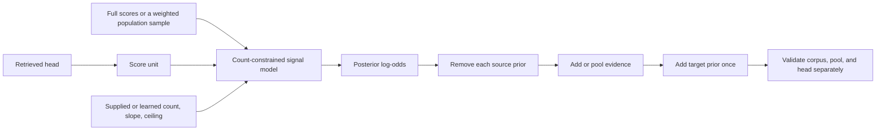

# Evidence calibration in the implementation

This guide applies *From Scores to Evidence* (November 14, 2026) to the library and its experiments. The executable example is `python -m examples.evidence_calibration` from the repository root.

## What the model guarantees

Given pre-offset evidence `g`, a count `R`, and a ceiling `omega`, the model is `p = omega * sigmoid(g - c)`. `calibrate_count` solves `sum(weight * sigmoid(g - c)) = R / omega` on the same reference population. It requires `0 < R < omega * sum(weight)` and rejects the zero-count boundary explicitly. This finite likelihood-ratio model does not represent a known impossible relevance event with a finite offset.

The count fixes a total. The slope determines its allocation along the ranking; the ceiling changes the allocation between the head and body. Neither score units nor the count constraint identify the slope or the ceiling. A requested result limit, a posting-list cardinality, and a SQL match count do not identify a semantic relevant-document count.

The implementation keeps the following quantities separate:

| Quantity | API | Meaning |
| --- | --- | --- |
| Latent ranking score | `ranking_score`, `get_ranking_scores` | `g - c`; use it to order capped models |
| Posterior log-odds | `log_odds`, `get_log_odds` | `logit(omega * sigmoid(g - c))` |
| Prior-free evidence | `evidence` | Posterior log-odds minus this model's own prior log-odds |
| Probability | `probability`, `get_probabilities` | The modeled relevance probability |
| Ranking bound | `upper_bound_ranking_score` | Bound in the latent ranking units |
| Posterior bound | `upper_bound_log_odds` | Bound after applying the ceiling |

For `omega < 1`, even the posterior log-odds eventually stop resolving differences. They approach `logit(omega)`. Ranking therefore retains the latent score rather than converting a capped probability back to a logit. Retrieval explanations expose both quantities. With a document-quality prior, retrieval selects the exact posterior top-k over the corpus.

`CalibrationContext` accompanies count and query models. It records the reference population, count source, slope source, ceiling source, and relevance target. These are provenance declarations, not evidence that a parameter was identified or that probabilities were validated.

## From retrieval to evidence



`calibrate_query` estimates lexical dispersion over matching documents. An observed BM25 score of zero still has evidence; it is not an absent observation. An unknown pruned score cannot be replaced by zero unless a specific tail approximation is being evaluated.

`tail_scale` is the mean of the top `k - 1` scores' excess above the k-th score. A zero result explicitly means that the head does not define a tail unit. A dense slope can use `1 / tail_scale(top_scores)` without observing the corpus bulk. Its intercept still requires the full population, a weighted sample representing it, or a stated approximation. `population_size` alone cannot invent the unseen dense scores.

Population weights in `calibrate_count` and `calibrate_query` represent multiplicities or inclusion weights. They are different from the relevance weights used to estimate a vector relevant-distance density.

## Evidence addition and opinion pooling

`posterior_to_evidence` removes the actual source prior from each posterior. `fuse_evidence` adds this evidence and the target prior once. Unit coefficients are justified by true conditional independence of likelihood ratios, not by numerical standardization of estimated scores.

`gaussian_evidence_weights` returns direct coefficients under its stated Gaussian model. They may be negative and need not sum to one. `evidence_upper_bound` uses an upper input bound for a positive coefficient and a lower input bound for a negative one. A negative coefficient with an unbounded lower input cannot support finite pruning.

`log_odds_fusion` is a confidence-scaled opinion pool. Its reliability weights remain nonnegative and sum to one. Without source-prior arguments it pools the supplied logits as given. With `input_prior_log_odds`, it removes those priors before gating and requires an explicit target `prior_logit`. The conjunction, learned-weight, attention, multi-head, and debugger APIs propagate the same distinction. Gating and min-max normalization define additional score models and do not preserve a likelihood-ratio interpretation automatically.

In query mode, `MultiFieldScorer` pools prior-free field evidence and solves one final corpus count and ceiling. Corpus mode retains the older posterior-pooling construction. Boolean event conjunction, disjunction, and complement remain distinct from evidence about one shared event.

Re-solving an intercept after fusion can enforce a supplied total. It does not identify that total or repair a misspecified dependence model.

## Vector backgrounds and selection

| Background | Posterior formula | Prior-free evidence |
| --- | --- | --- |
| Non-relevant class density | `sigmoid(log(a_R * f_R_A / f_0) + logit(pi))` | `log(a_R * f_R_A / f_0)` |
| Marginal corpus density | `pi * a_R * f_R_A / f_G` | Logit of that posterior minus `logit(pi)` |

Here `a_R` is `relevance_recall`: the fraction of corpus relevance inside the density sample's retrieval range. It is applied before posterior conversion. Its default of one is a convention. A result-list length or the fraction of retrieved documents in the corpus does not identify it.

`VectorProbabilityTransform.fit_background` defaults to a marginal KDE and retains its sample. `background_model="gaussian"` is an explicit tail-shape assumption. Constructing a model directly from Gaussian moments retains the non-relevant-background default for compatibility; `background_kind` makes another role explicit. Historical benchmark ablations name their Gaussian and approximate-posterior choices.

`log_density_ratio` reports the literal ratio. Against the marginal background it is pointwise mutual information, not a likelihood ratio. Use `evidence` or `evidence_with_sample` for evidence consistent with the selected posterior. Estimated densities may violate the exact marginal formula's upper probability limit; the numerical estimator caps this limit. This is separate from the fitted relevance ceiling.

External weights take precedence over automatic gap detection and are not sharpened implicitly. `weight_temperature` explicitly requests that different estimator. Imperfect weights can estimate a contaminated relevant/background mixture. They need not satisfy the conditional independence assumption needed to identify a relevant density.

`knn_density_prior` uses `sigmoid(gamma * (kth_distance / global_median_kth - 1))`: sparse neighborhoods receive the larger value. IVF query backgrounds use query-to-centroid similarities and cell moments, with scored cells contributing their observed query distances. Document-to-centroid residuals are a different variable and remain a named ablation.

## Judgment target and empirical calibration

The ceiling experiment targets `judged_relevance`. Unjudged BEIR documents have label zero. A fitted ceiling is not automatically the probability of answer correctness, nor a probability that a truly relevant document was judged. The latter reading requires an additional selection model, including score-independent selection among relevant documents; pooled judgments do not guarantee it.

`calibration_report_from_log_odds` requires an evaluation context. `CalibrationAccumulator` streams weighted log-odds without probability clamping. Both expose log-loss skill, count ratio, and calibration slope, alongside ECE and Brier diagnostics. The skill baseline is the prevalence of the evaluated population. Corpus, candidate-pool, and top-ten results therefore have different baselines and must be reported separately.

## Reproduction

The default identity is exact `(title, body)` for documents and exact query text. Alias qrels merge at their maximum grade. Query copies are excluded before retrieval, background estimation, and count solving. Cross-validation folds contain canonical queries. `--identity id` selects the evaluator-style comparison, and `protocol_diagnosis` runs both identities. Cache fingerprints include model, exact ordered inputs, identity, and protocol context. Shape-only caches are re-encoded.

The paper grids contain twelve ceilings and thirteen slopes. The count is the training-query mean. Thirty sure judgments select a ceiling; ninety stratified judgments select ceiling and slope, with ten draws. The sure-document estimate is exactly the observed relevant fraction; it has no pseudocount, prior, shrinkage, or projection onto the grid. Draws never repeat a query-document pair. If a stratum has fewer than thirty observations, all available observations are used and the actual budget is recorded. A channel with no sure observations cannot provide an estimate. A zero empirical ceiling cannot satisfy a positive supplied count. These cases are recorded as unavailable rather than replaced by another calibration rule; tables display `--`.

Collection transfer minimizes mean relative log-loss regret over the source collections and never uses target labels to select constants. Training and held-out predictions within a CV fold use the same mean count from that fold's training queries. The tail depth is 100; the quarter-corpus sample uses seed 7. Restricting a corpus keeps each document's original evidence and original score units, as required by Proposition 3.25.

Grid fits accelerate repeated full-population solves with positive discrete Gaussian quadrature. An analytic logistic remainder bound and measured moment residuals bound each count calculation; insufficient precision falls back to literal full-array solving. Selected models are evaluated with the ordinary full-array solver. This uses every document, without substituting a sampled or truncated count population.

Use a separate result directory so older id-identity results are not mixed with this protocol:

```sh
python -m benchmarks.hybrid_beir -d <beir> -o <results>/hybrid_beir.json
python -m benchmarks.hybrid_beir -d <beir> --dense-backend ivf -o <results>/hybrid_beir_ivf.json
python -m benchmarks.hybrid_beir -d <beir> --dense-backend ivf --ivf-background residuals -o <results>/hybrid_beir_ivf_residuals.json
python -m benchmarks.reevaluation -d <beir> -o <results>/reevaluation.json
python -m benchmarks.reevaluation -d <beir> --model all-mpnet-base-v2 -o <results>/reevaluation_mpnet.json
python -m benchmarks.ceiling_slope -d <beir> --workers 5 -o <results>/ceiling_slope.json
python -m benchmarks.ceiling_slope -d <beir> --workers 5 --model all-mpnet-base-v2 -o <results>/ceiling_slope_mpnet.json
python -m benchmarks.protocol_diagnosis -d <beir> -o <results>/protocol_diagnosis.json
python -m benchmarks.paper_tables --results <results> --out <results>/tables
python -m benchmarks.gap_duplicates
```

`ceiling_slope --resume` requires matching protocol metadata. Intermediate grid caches include the encoder and dataset fingerprint. Quarter-corpus experiments hold original scores and units fixed; they do not establish transfer after reindexing. Query bootstrap intervals and judgment-draw variability are recorded separately. Benchmark stage totals include many experimental variants and fitting work; they are not serving latency.

## Additional experiments

`benchmarks/additional/` contains experiments beyond the manuscript: equal-budget logistic and tuned convex baselines, jointly fitted slopes in tail units, alternative rank-tie handling, and query processing cost. The paper runners do not import or execute these experiments. Their outputs belong in `<results>/additional/`, separately from Tables 1 to 23 and the paper's measured quantities.

The equal-budget runner regenerates and verifies the exact saved query-document judgments before fitting its alternatives. Its convex weight and monotone logistic map use those same labels. These are additional comparisons, not corrections applied to the paper model.

```sh
python -m benchmarks.additional.equal_budget -d <beir> --paper-results <results>/ceiling_slope.json -o <results>/additional/same_budget_all-MiniLM-L6-v2.json
python -m benchmarks.additional.equal_budget -d <beir> --paper-results <results>/ceiling_slope_mpnet.json -o <results>/additional/same_budget_all-mpnet-base-v2.json
python -m benchmarks.additional.calibration_cost -d <beir> --query-limit 50 -o <results>/additional/calibration_cost.json
python -m benchmarks.additional.calibration_cost -d <beir> --query-limit 50 --model all-mpnet-base-v2 -o <results>/additional/calibration_cost_mpnet.json
python -m benchmarks.additional.tables --results <results> --out <results>/additional/tables
```

The cost experiment measures an exhaustive NumPy pipeline with fresh query encoding after model warmup. It records a uniform sample of fifty queries per collection, p50/p95 query times, bootstrap intervals, setup costs, and stage costs. Its supplied count of one and ceiling of 0.6 are cost-measurement conventions, not estimated collection parameters. Corpus indexing and embeddings are setup costs. These timings do not measure a pruned retrieval engine or an ANN service.

The local run and its measured agreement with the manuscript are recorded in [evidence-reproduction.md](evidence-reproduction.md).
